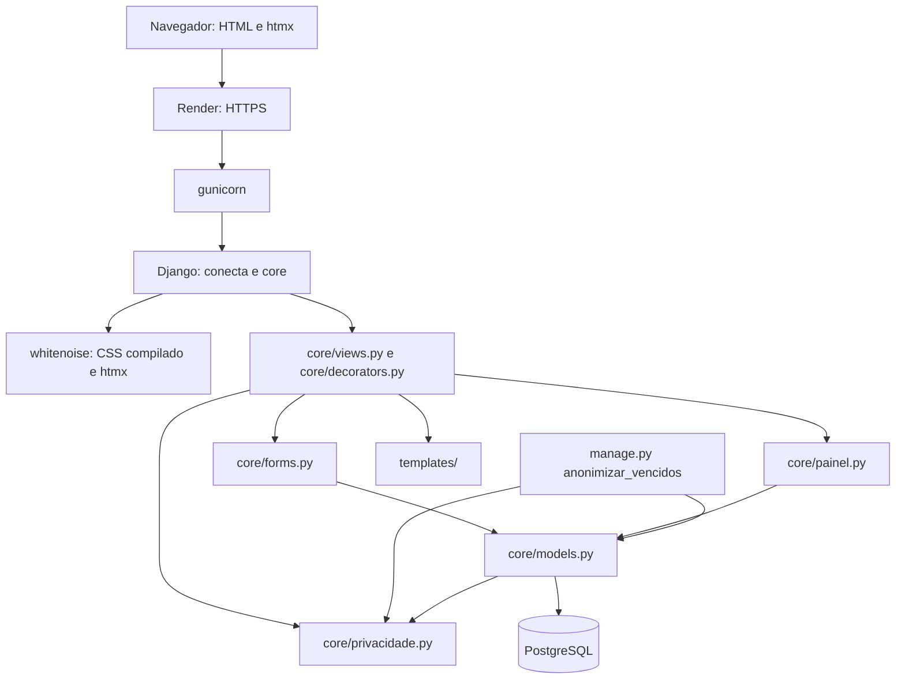

# Documentação Final — Conecta Social

**Deploy definitivo:** https://conecta-social-wcxa.onrender.com/  
**Repositório:** https://github.com/Antonio-pf/projeto-eng-soft

**Equipe:**
- Alexandre Victoriano Ribeiro Ulhoa — RA 2840482423007
- Antonio Pires Felipe — RA 2840482211003
- Daniel Souza Monteiro de Carvalho — RA 2840482211052
- Luiz Henrique Neres — RA 2840482423005

## 1. Índice de artefatos do semestre
| Entrega | Documento | Link |
|---|---|---|
| E1 | Documento de Visão | `docs/documento-de-visao.md` |
| E2 | Backlog + Termo de Aceite do Projeto | `docs/backlog.md`, `docs/termo-aceite.md` |
| E3 | UML + DER + DDL | `docs/uml.md`, `docs/der.md`, `db/schema.sql` |
| E4 | README + Protótipo + Plano de Testes | `README.md`, `docs/prototipo.md`, `docs/plano-de-testes.md` |
| E5–E8 | Relatórios de sprint | `docs/sprints/sprint-{1,2,3,4}-relatorio.md`, `docs/sprints/sprint-{1,2,3,4}-retrospectiva.md`, `docs/sprints/sprint-{1,2,3,4}-evidencias-teste.md`, `docs/sprints/sprint-{1,2,3,4}-contribuicao-*.md` |
| E9 | Relatório de testes + Termo de Aceite do Cliente | `docs/relatorio-testes-final.md`, `docs/termo-aceite-cliente.md` |

*Rastreabilidade requisito → modelo → código → teste: cada história do `docs/backlog.md` leva ao caso de uso pela seção 3 do `docs/uml.md` (histórias #1 a #23; as #24 a #28 vieram depois da E3 e não estão no diagrama), e as entidades do modelo estão no `docs/der.md` e no `db/schema.sql`. A seção 1 de cada relatório de sprint aponta o PR que entregou a história, quando houve PR, e as evidências de teste da sprint apontam o teste automatizado em `core/tests.py`. O caso de teste de cada história está na seção 3 do `docs/plano-de-testes.md`, e o resultado final, com o PR das histórias entregues depois da Sprint 4, está na seção 2 do `docs/relatorio-testes-final.md`.*

## 2. Desvios do escopo original (vs. E2b)
| Item | Mudou? | Justificativa |
|---|---|---|
| Stack do frontend | Mudou de Tailwind CSS e daisyUI por CDN (planejado na E2b) para CSS compilado no build e htmx 2.0.11 versionado no repositório | O CSS compilado (PR #40, 02/10) mantém o mesmo visual e faz o navegador baixar cerca de 10 KB em vez de 3,3 MB. O htmx (PR #56, 30/10) abre cadastros e movimentações em modal e filtra as listas sem recarregar, sem trocar o Django Templates; fica em `static/js`, sem CDN, e as páginas continuam funcionando sem JavaScript |
| Quantidade nas doações e distribuições (#14 e #16) | Mudou de número inteiro (critério de aceite) para número decimal | Decidido na Sprint 2 para registrar itens fracionados, como meio pacote ou 2,5 kg; o DDL da E3 já previa `NUMERIC(10,2)`. A vírgula decimal entrou com a história #27 |
| Cancelamento de movimentação (#19, Could, fora do E2b) | Entregue em 02/11 (PR #63), com o estorno marcado na própria movimentação em vez de um registro de estorno separado | O registro original fica no histórico com o selo de cancelado, a data e o administrador que cancelou, e o saldo volta ao valor anterior. Só o Administrador cancela, e fica bloqueado o cancelamento de doação que deixaria o saldo negativo |
| Escopo acrescentado | Entraram a página inicial pública (PR #42, 03/10) e as histórias #24 (painel do mês), #25 (aviso de privacidade e retenção dos dados), #26 (sinal de carregamento), #27 (máscaras nos campos) e #28 (fotos da equipe), entregues entre 03/11 e 06/11 | Acréscimos, sem tirar nada do E2b; cada história tem critérios de aceite no backlog e caso de teste (CT33 a CT41). A #25 fecha a lacuna de LGPD apontada no relatório da Sprint 4 |
| Cadastro de doador | Mudou de só o Administrador (E2b) para Voluntário e Administrador | O E2b cita a história #5, em que o Voluntário cadastra o doador para registrar a doação no atendimento, e o sistema seguiu a história. A edição do doador (#7) continua só do Administrador |

## 3. Arquitetura final (resumo)
Sem mudanças estruturais desde a E4: monolito Django com uma única app (`core`), páginas montadas no servidor pelo Django Templates, PostgreSQL como banco único e deploy no Render, com gunicorn e os arquivos estáticos servidos pelo whitenoise. O Docker Compose continua como alternativa para rodar localmente.
As mudanças depois da E4 ficaram dentro dessas camadas: CSS compilado no build (PR #40), agregações do painel em `core/painel.py` (PR #47), banco alinhado ao DDL da E3, com os nomes das colunas de chave estrangeira e os CHECK do `db/schema.sql` (PR #55), htmx para modais e filtros sem recarregar (PR #56), HTTPS obrigatório, cookies seguros, HSTS e registro dos erros em produção (PR #58), cobertura mínima de 95% no CI (PR #66) e o aviso de privacidade em `/privacidade/`, com as regras em `core/privacidade.py` e o comando `anonimizar_vencidos` (PR #69). Nesta entrega, o `render.yaml` passou a declarar em `ALLOWED_HOSTS` o endereço publicado.

Texto alternativo: o navegador acessa o Render por HTTPS, que repassa ao gunicorn e ao Django. O whitenoise entrega o CSS compilado e o htmx. As views, protegidas pelos decorators de login e de perfil, usam os forms, o `painel.py` (agregações), o `privacidade.py` (textos e prazo do aviso) e os templates. Forms, painel e o comando `anonimizar_vencidos` usam os models, que leem e gravam no PostgreSQL; o comando e os models tiram o prazo de retenção do `privacidade.py`.

## 4. Como contribuir/rodar
Ver `README.md` na raiz — atualizado nesta entrega com as variáveis opcionais `ONG_NOME` e
`ONG_CONTATO_PRIVACIDADE` (aviso de privacidade, PR #69) no passo 3 e, no passo 5, a tabela
dos usuários de teste criados pelo seed e o comando `anonimizar_vencidos`.
