# Manual do Usuário — Conecta Social

**Entrega E10 · Laboratório de Engenharia de Software · ADS · Fatec Ribeirão Preto · 2026/2**

**Versão 1.0 · 08/11/2026**

**Equipe**

- Alexandre Victoriano Ribeiro Ulhoa — RA 2840482423007
- Daniel Souza Monteiro de Carvalho — RA 2840482211052
- Antonio Pires Felipe — RA 2840482211003
- Luiz Henrique Neres — RA 2840482423005

O Conecta Social ajuda a ONG a registrar doações, consultar o estoque e controlar entregas às famílias. Este manual explica o uso por perfil.

### Como entrar no sistema

Para utilizar o sistema, você precisa de uma conta ativa, navegador e conexão com a internet. Não compartilhe sua senha.

1. Acesse https://conecta-social-wcxa.onrender.com/ e clique em Entrar no Conecta.
2. Informe o e-mail e a senha fornecidos e clique em **Entrar no Conecta**.
3. Confira seu perfil de acesso no rodapé do menu lateral. Ele define os comandos disponíveis.
4. Para encerrar a sessão, clique em **Sair** no rodapé do menu lateral.

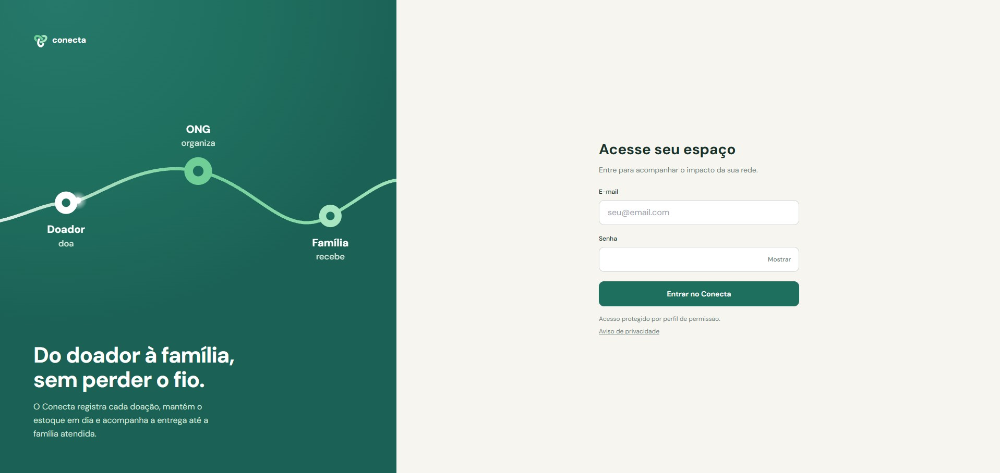

## Para o administrador

A seguir, são apresentadas as ações exclusivas do perfil Administrador, que também pode realizar todas as tarefas do perfil Voluntário.

### Gerenciar usuários

No menu lateral, abra **Administração → Usuários**.

#### Como cadastrar um usuário

1. Na seção Novo Usuário, preencha os campos **Nome**, **E-mail** e **Senha**.
2. No campo **Perfil**, selecione Administrador ou Voluntário, conforme as atividades que o usuário realizará.
3. Confira os dados e clique em Salvar.
4. Verifique se o novo usuário aparece na lista abaixo do formulário.

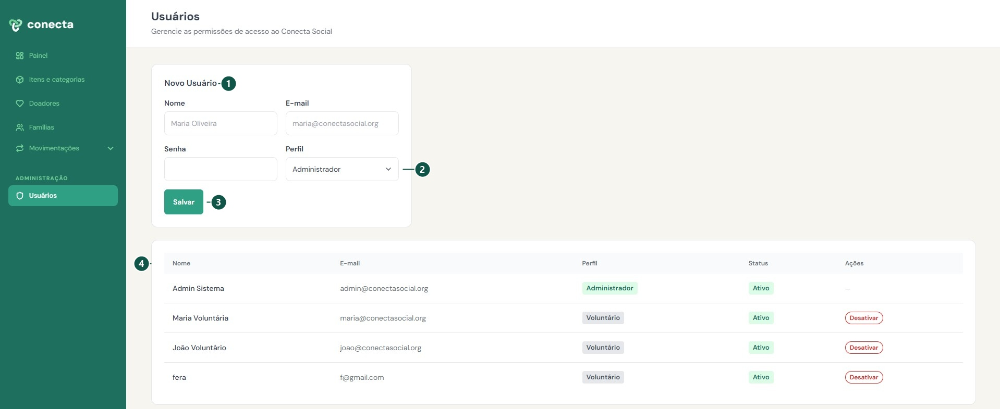

#### Como desativar um acesso

1. Na lista de usuários, localize a conta que deseja desativar.
2. Na coluna Ações, clique em Desativar.
3. Na janela de confirmação, clique em **Desativar acesso**. Para desistir, clique em Cancelar.
4. Confira se o status do usuário mudou para Inativo.

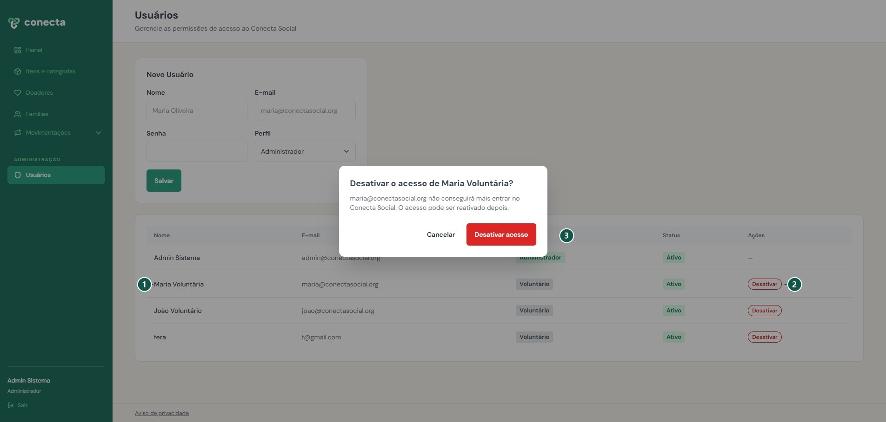

#### Como reativar um acesso

1. Na lista de usuários, localize a conta com status **Inativo**.
2. Na coluna Ações, clique em Ativar.
3. Confira se o status do usuário mudou para **Ativo**.

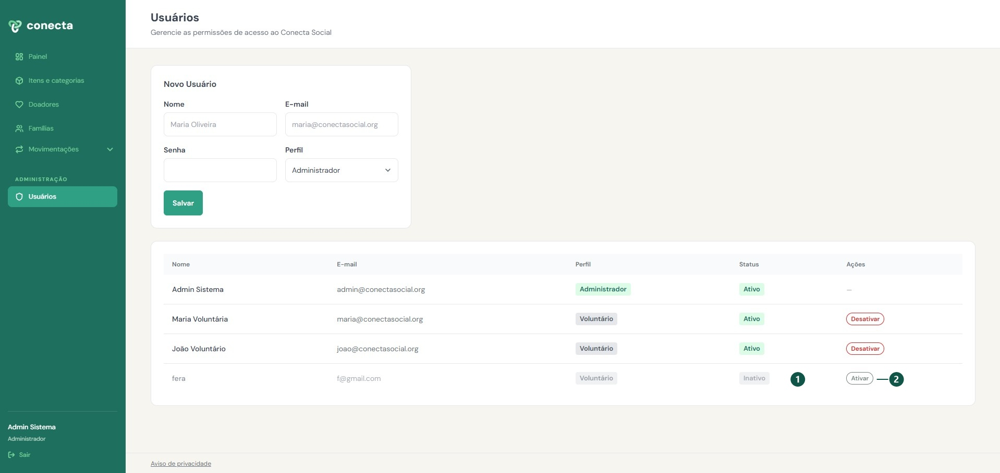

### Gerenciar itens e categorias

#### Como criar uma nova categoria

1. No menu lateral, abra Itens e categorias.
2. Clique em + Nova categoria.
3. Informe o **Nome da Categoria**, por exemplo, Eletrodoméstico. Preencha a **Descrição** se precisar explicar quais itens pertencem ao grupo.
4. Clique em **Salvar categoria**.
5. Abra a aba **Categorias** e confira se o cadastro aparece na lista.

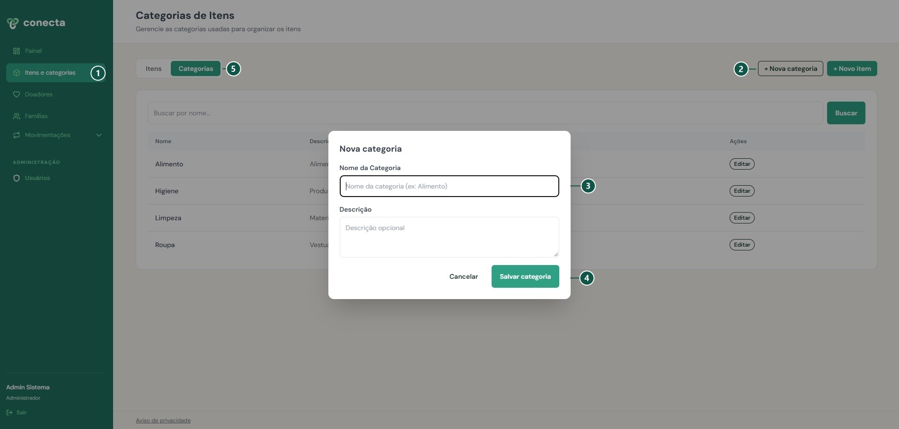

#### Como editar uma categoria já criada

1. Em Itens e categorias, abra a aba Categorias.
2. Localize a categoria que deseja alterar e clique em Editar.
3. Ajuste os dados e clique em Salvar alterações.
4. Confira as informações atualizadas na lista.

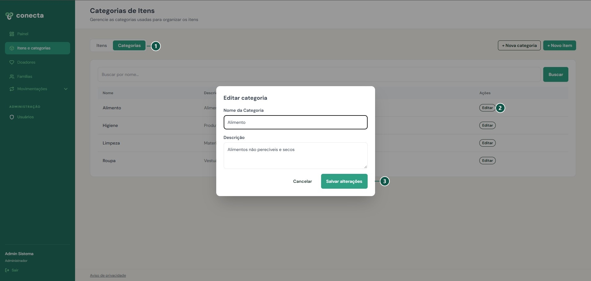

#### Como cadastrar um item

1. No menu lateral, abra Itens e categorias.
2. Na aba Itens, clique em + Novo item.
3. Preencha Nome do Item com uma identificação clara, por exemplo Arroz 5kg.
4. Selecione a Categoria e a Unidade de Medida, conforme a forma usada pela ONG para contar o produto.
5. Informe o Estoque Mínimo com um número inteiro maior ou igual a zero. Esse valor serve de referência para os alertas de reposição.
6. Clique em **Salvar item** e confira o cadastro na lista.

Para adicionar quantidades ao saldo do item, registre uma doação recebida.

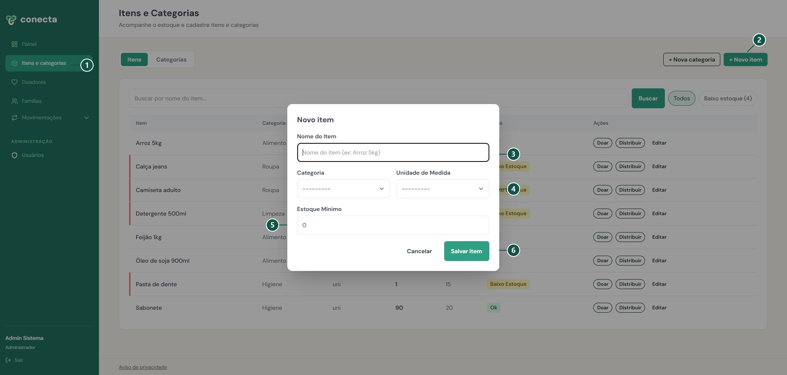

#### Como editar um item

1. Em Itens e categorias, abra a aba Itens.
2. Localize o item que deseja alterar e clique em Editar.
3. Ajuste os dados e clique em Salvar alterações.
4. Confira as informações atualizadas na lista.

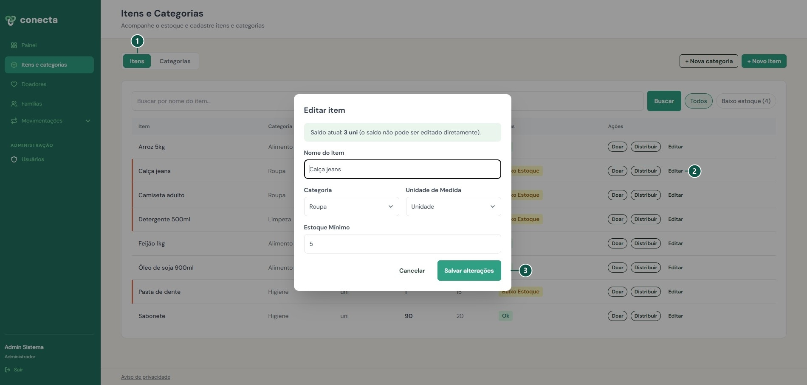

### Gerenciar doadores

#### Como editar os dados de um doador cadastrado

1. No menu lateral, clique em Doadores.
2. Localize o cadastro que deseja alterar e clique em Editar.
3. Revise os dados e clique em **Salvar alterações**.
4. Verifique se as informações foram atualizadas na lista de doadores.

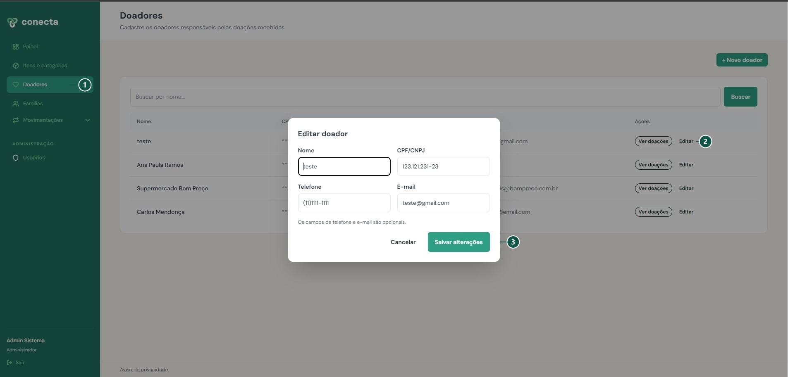

## Para o voluntário

### Como cadastrar uma família

1. No menu lateral, clique em Famílias.
2. Clique em **+ Nova família**.
3. Preencha **Nome do Responsável**, **Número de Membros** e **Endereço**. O **Telefone** é opcional. Se disponível, informe-o com DDD.
4. Explique ao responsável para que os dados serão usados e como solicitar a correção ou exclusão deles.
5. Clique em **Salvar família**.
6. Confira se a família aparece na lista de Famílias Beneficiadas.

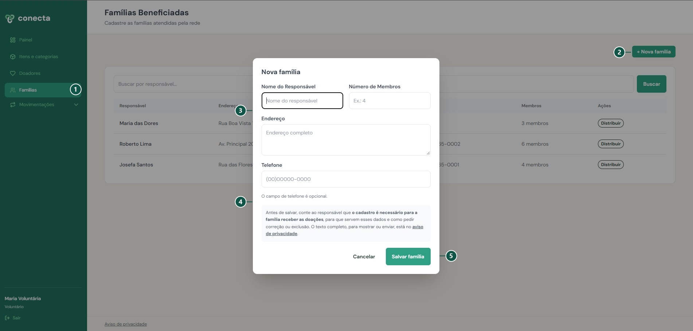

### Como consultar uma família cadastrada

1. No menu lateral, clique em Famílias.
2. No campo Buscar família, digite o nome do responsável e clique em Buscar.
3. Localize a família na lista de Famílias Beneficiadas.
4. Na linha da família, consulte o Endereço, o Telefone, quando informado, e o número de Membros.

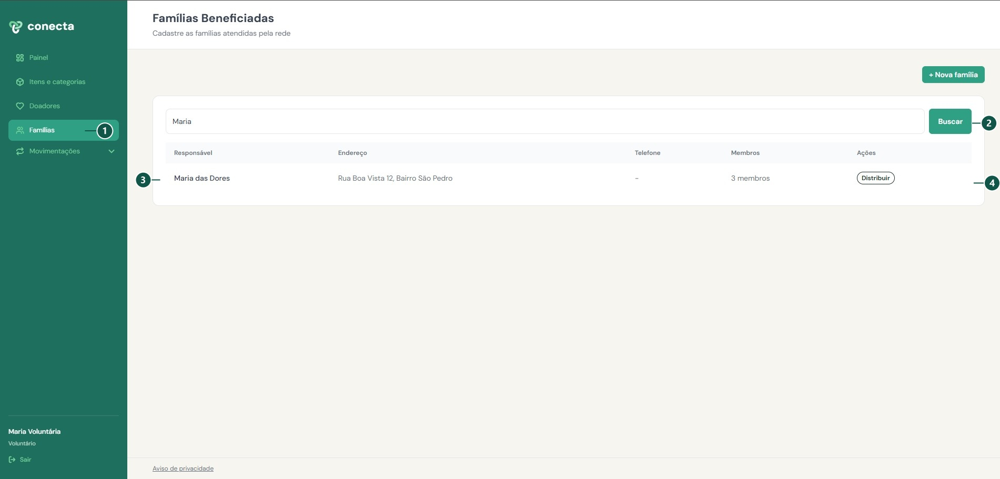

### Como cadastrar um novo doador

1. No menu lateral, clique em Doadores.
2. Clique em + Novo doador.
3. Preencha Nome e CPF/CNPJ. O CPF deve ter 11 dígitos, e o CNPJ, 14.
4. Se disponíveis, informe o Telefone com DDD e o E-mail. Esses campos são opcionais.
5. Explique ao doador para que os dados serão usados e como solicitar a correção ou exclusão deles. O formulário tem um link para o Aviso de privacidade.
6. Clique em Salvar doador e confira se o cadastro aparece na lista.

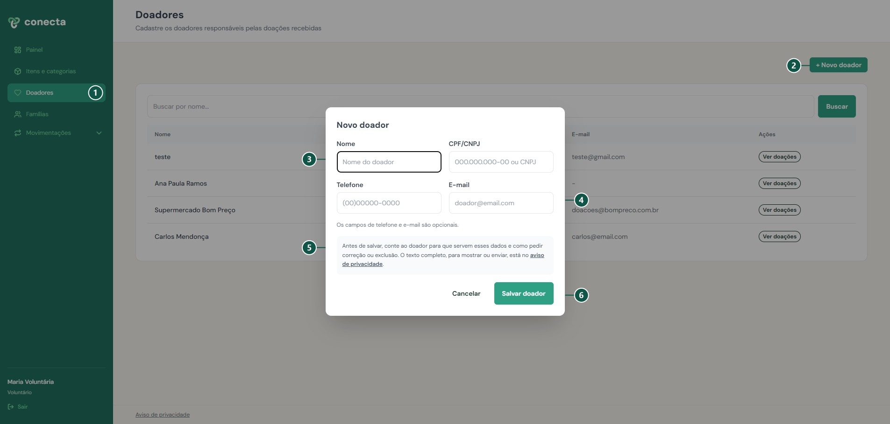

### Como consultar doadores cadastrados

1. No menu lateral, clique em Doadores.
2. No campo Buscar doador, digite o nome ou parte dele e clique em Buscar.
3. Localize o doador na lista e confira os dados exibidos.
4. Para consultar as contribuições registradas, clique em Ver doações na linha do doador.

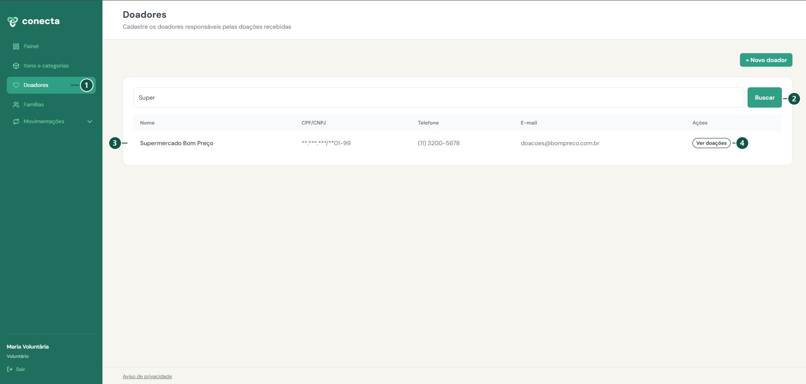

### Como registrar uma doação recebida

1. No menu lateral, abra Movimentações e clique em Nova doação.
2. Selecione o **Doador** e o **Item**. Informe a **Quantidade** recebida e a **Data** da doação. Se o item ainda não estiver cadastrado, solicite o cadastro ao administrador.
3. Revise os dados e clique em Registrar doação. O sistema acrescenta a quantidade ao saldo do item.
4. Clique em Ver histórico de doações para conferir o registro.

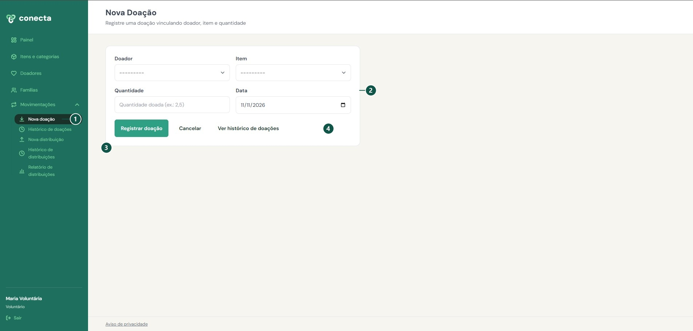

### Como consultar o histórico de doações

1. No menu lateral, abra **Movimentações** e clique em **Histórico de doações**.
2. Selecione o doador ou mantenha **Todos os doadores**.
3. Informe a **Data inicial** e a **Data final** e clique em **Filtrar**. Para consultar um único dia, informe a mesma data nos dois campos. Você também pode usar os atalhos Este mês, Últimos 30 dias e Este ano.
4. Em Totais por doador e item, confira quanto cada doador contribuiu de cada item no período selecionado.
5. Em Doações registradas, confira os detalhes de cada doação, como a data, o item, a quantidade e quem fez o registro.

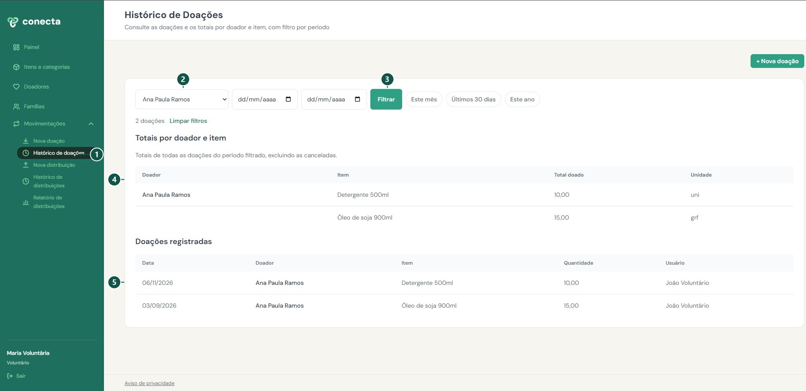

### Como consultar o estoque

1. No menu lateral, clique em Itens e categorias e abra a aba Itens.
2. No campo Buscar item, digite o nome do item e clique em Buscar.
3. Na linha do item, confira a Unidade e o Saldo. Por exemplo, se a unidade for Pacote e o saldo for 10, há 10 pacotes disponíveis.
4. A coluna Mín indica o estoque mínimo definido para o item.
5. Para ver somente os itens que precisam de reposição, selecione Baixo estoque. Para voltar à lista completa, selecione **Todos** e limpe o campo de busca, se necessário.

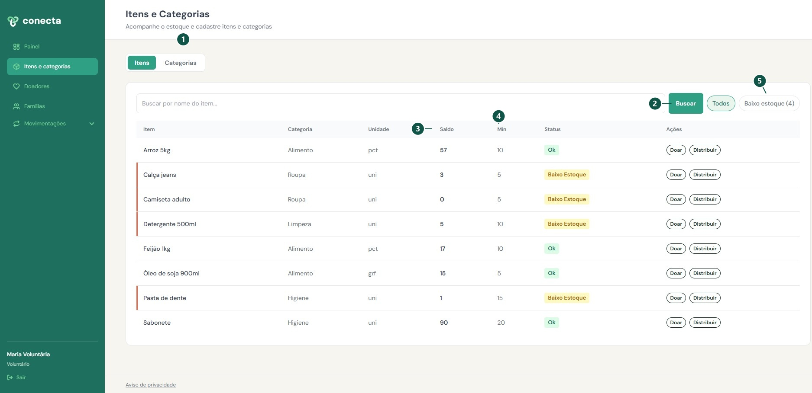

### Como registrar uma nova distribuição

1. No menu lateral, abra Movimentações e clique em Nova distribuição.
2. Selecione a **Família** destinatária da entrega.
3. Selecione o **Item** e confira o saldo disponível exibido na tela.
4. Informe a **Quantidade** entregue e, no campo **Data**, indique o dia da entrega.
5. Se aparecer o aviso Maior que o saldo disponível, confira a quantidade informada e o saldo do item antes de prosseguir.
6. Revise os dados e clique em **Registrar distribuição**. O sistema desconta a quantidade do estoque e exibe a mensagem Distribuição registrada com sucesso! no canto inferior da tela.

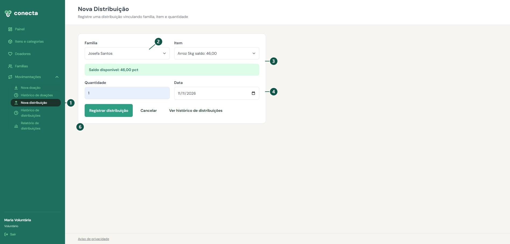

### Como consultar o histórico de distribuições

O histórico mostra cada entrega registrada.

1. No menu lateral, abra Movimentações e clique em Histórico de distribuições.
2. Selecione a **Família** que deseja consultar ou mantenha **Todas as famílias**.
3. Informe a **Data inicial** e a **Data final** e clique em **Filtrar**. Para consultar um único dia, informe a mesma data nos dois campos. Você também pode usar os atalhos Este mês, Últimos 30 dias e Este ano.
4. Na lista de resultados, confira a Data, a Família, o Item, a Quantidade e o Usuário que registrou a distribuição.
5. Se precisar baixar os registros exibidos, clique em Exportar CSV.

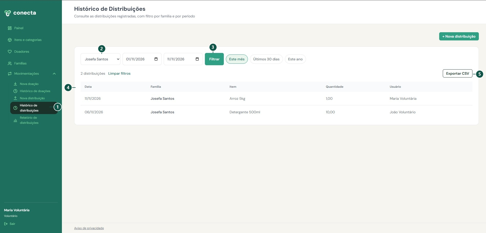

### Como consultar o relatório de distribuições

O relatório reúne os totais por família e item no período selecionado.

1. No menu lateral, abra Movimentações e clique em Relatório de distribuições.
2. Selecione uma **Família** ou mantenha **Todas**.
3. Preencha **Período início** e **Período fim** e clique em **Filtrar**.
4. Na tabela, confira **Família**, **Item**, **Categoria**, **Qtd total**, **Nº distribuições** e **Último registro**.
5. Se precisar baixar os registros exibidos, clique em Exportar CSV.

Abaixo da tabela, os cartões mostram **Total distribuído**, **Famílias atendidas** e **Distribuições no período**.

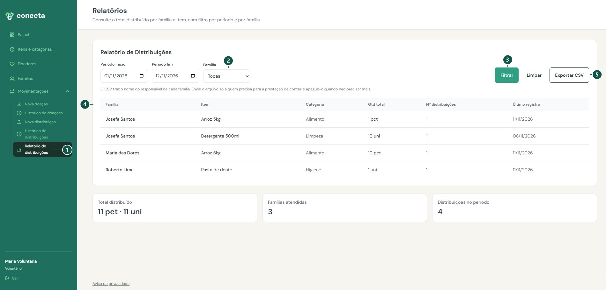

## Perguntas frequentes

**Não consigo entrar. O que faço?**

Confira o e-mail e a senha. Use Mostrar para conferir a digitação. Se o problema continuar, procure o administrador para verificar se a conta está ativa.

**Por que não consigo cadastrar um item?**

O cadastro e a edição de itens e categorias são exclusivos do administrador. O voluntário consulta o catálogo e pede ao administrador a inclusão do que estiver faltando.

**Cadastrar um item já aumenta o estoque?**

Não. O cadastro define nome, categoria, unidade e estoque mínimo. A quantidade disponível aumenta ao registrar uma doação e diminui ao registrar uma distribuição.

**Por que não consigo salvar um doador?**

Confira se o CPF tem 11 números ou o CNPJ tem 14. O documento não pode estar cadastrado em outro registro. Confira também os campos destacados na tela.

**Posso registrar doação ou distribuição com data futura?**

Não. Informe a data atual ou a data anterior em que a movimentação realmente ocorreu.

**Como corrigir um registro?**

O administrador pode editar itens, categorias e dados dos doadores pelos comandos Editar. Para corrigir uma movimentação ou os dados de uma família, procure o administrador antes de fazer outro lançamento, evitando duplicidade.

**Por que o histórico não mostra o registro que procuro?**

Confira o doador ou a família selecionados e o intervalo de datas. Amplie o período e clique em Filtrar novamente.

**Como os dois perfis se diferenciam?**

Ambos cadastram famílias e doadores, registram doações e distribuições e consultam o estoque e os históricos. O administrador também cadastra e edita itens e categorias, corrige doadores e gerencia usuários.
