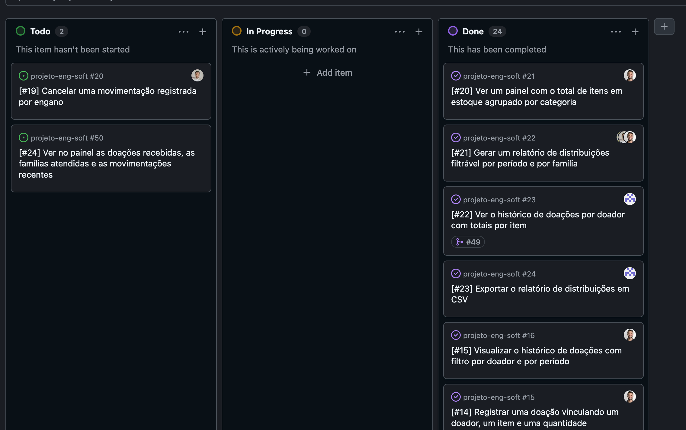

# Relatório de Entrega — Sprint 4 — Conecta Social

**Período:** 17/10/2026 a 30/10/2026 (Sprint 4, semanas 11–12)
**Sprint Review:** 23/10/2026, encontro online. Participantes: Alexandre Ulhoa, Daniel Carvalho, Antonio Felipe e Luiz Henrique

**Equipe:**
- Alexandre Victoriano Ribeiro Ulhoa — RA 2840482423007
- Daniel Souza Monteiro de Carvalho — RA 2840482211052
- Antonio Pires Felipe — RA 2840482211003
- Luiz Henrique Neres — RA 2840482423005

> Rascunho escrito em 28/10/2026 e atualizado em 29/10/2026, com a `main` no commit `58ef94a` (merges dos PRs #54, #53 e #51).

## 1. Planejado vs. entregue

O backlog não registra um planejamento próprio da Sprint 4. A sprint ficou com as histórias que sobraram da Sprint 3 (#19 a #22) e com a #24, que estava sem sprint. [confirmar com a equipe o que foi planejado]

| História (E2) | Planejada para esta sprint? | Entregue? | Observação |
|---|---|---|---|
| #20 — Painel com total de itens em estoque por categoria | Sim (remanescente da Sprint 3) | Sim | PR #47, integrado em 28/10/2026 sem revisão registrada. Mostra os indicadores "Itens em estoque" e "Itens em alerta", o estoque por categoria com o percentual de itens acima do mínimo e os pontos de atenção (até 5 itens de menor saldo), seguindo o frame `2603:39` do protótipo |
| #22 — Histórico de doações por doador com totais por item | Sim (remanescente da Sprint 3) | Sim | PR #49 (Daniel Souza), revisado e aprovado por Antonio Felipe e integrado em 28/10/2026. A tela `/doacoes/` ganhou a tabela "Totais por doador e item", que respeita os filtros de doador e período e exclui as doações canceladas |
| #21 — Relatório de distribuições filtrável por período e família | Sim (remanescente da Sprint 3) | Sim | PR #53, integrado em 29/10/2026 sem revisão registrada. Luiz Henrique refez a implementação a partir da `main` atual, sem a pasta `venv/` (commit `56ce3c6`): rota `/distribuicoes/relatorio/`, agrupamento por família e item, filtros por período e família e 5 testes. Antonio Felipe, com a participação de Alexandre Ulhoa, alinhou a tela ao protótipo, com o resumo por unidade, o link de exportação CSV com os filtros aplicados e o item no menu lateral, ajustou esses testes e acrescentou mais 9 (commit `d8c463f`) |
| #19 — Cancelar uma movimentação registrada por engano | Sim (remanescente da Sprint 3) | Não | Não iniciada. Issue reaberta e card em "Todo" desde 28/10/2026 |
| #24 — Painel com doações recebidas, famílias atendidas e movimentações recentes | [confirmar] | Não | Ganhou a issue #50 e entrou no board em "Todo" em 28/10/2026 |
| Requisitos não funcionais do cronograma: segurança (OWASP), LGPD e preparação de deploy | Sim (cronograma da disciplina) | Em parte | Inventário e lacunas na [seção 7](#7-segurança-lgpd-e-preparação-de-deploy). HTTPS obrigatório, cookies seguros, HSTS e registro dos erros 500 no PR #58 (branch `fix/seguranca-producao`). A LGPD ainda não tem aviso ao titular nem base legal registrada |
| Correções da E4 pedidas pelo professor (README no setup nativo e link único do protótipo) | Sim | Sim | PR #46, integrado em 28/10/2026 sem revisão registrada |
| Correções de forma da E2 e da E3 (título da seção de escopo no termo de aceite e RAs no DDL) | Não | Sim | PR #51 (Antonio Felipe), integrado em 29/10/2026 sem revisão registrada |
| Simplificação de filtros, formulários e painel, com filtros inválidos nas listas ignorados em vez de gerar erro | Não | Sim | PR #54 (Antonio Felipe), integrado em 29/10/2026 sem revisão registrada, com 1 teste novo |
| Documentos da Sprint 3 (E7), entregues com atraso | Não | Em andamento | Branch `docs/sprint-3` |

## 2. Incremento funcional demonstrável

O sistema está no ar em https://conecta-social-wcxa.onrender.com/. Em 28/10/2026 o deploy estava fora do ar porque o banco PostgreSQL gratuito do Render expirou. Um banco novo foi criado, as migrations rodaram no deploy e o `seed` foi executado. Depois disso, `/health/` respondeu 200, o login com `admin@conectasocial.org` redirecionou para `/painel/` e as telas `/painel/`, `/itens/` e `/distribuicoes/` abriram com os dados do `seed`.

- **Painel (#20), em `/painel/`:** os indicadores "Itens em estoque" (com a variação em relação ao fim do mês anterior) e "Itens em alerta"; o estoque por categoria, com totais separados por unidade e o percentual de itens acima do mínimo; e os pontos de atenção, com link para a lista de itens. O painel é o mesmo para Voluntário e Administrador.
- **Relatório de distribuições (#21), em `/distribuicoes/relatorio/`:** tabela agrupada por família e item, com categoria, quantidade total, número de distribuições e data do último registro; filtros por período e família, isolados ou combinados; resumo com os totais por unidade e o número de famílias e distribuições; e o botão de exportação CSV, que leva os mesmos filtros. Fica no menu lateral, no grupo Movimentações.
- **Totais por doador e item (#22), em `/doacoes/`:** abaixo dos filtros, a tabela agrupa as doações do período por doador e item, com o total doado, a unidade e o número de doações registradas. Os totais consideram todos os registros filtrados, não só os da página atual.

[GIF ou prints das telas do painel, do relatório de distribuições e dos totais por doador rodando no deploy — gravar até 30/10]

**Como reproduzir localmente** (passo a passo completo no [`README.md`](../../README.md)):

```bash
source .venv/bin/activate
npm install && npm run build
python manage.py migrate
python manage.py seed
python manage.py runserver
```

Acesse `http://127.0.0.1:8000/login/` com um dos usuários de teste do `seed` (lista em [`README.md` → "Usuários de teste"](../../README.md#usuários-de-teste)). Telas desta sprint: `/painel/`, `/distribuicoes/relatorio/` e `/doacoes/`.

## 3. Backlog atualizado

Link do board: https://github.com/users/Antonio-pf/projects/11



Mudanças de status na Sprint 4, até 30/10/2026:

- **Done:** #20 (painel) e #22 (totais por doador), as duas movidas depois do merge de 28/10/2026, e #21 (relatório de distribuições), que entrou na `main` em 29/10/2026 pelo PR #53.
- **In Progress:** nenhum card.
- **Todo:** #19 (cancelar movimentação), que teve a issue reaberta em 28/10/2026, e #24, que ganhou a issue #50.

## 4. Evidências de teste

121 testes automatizados (`python manage.py test`), 100% passando no commit `58ef94a`, executados em 29/10/2026. São 31 novos nesta sprint: 13 do painel (#20), 3 dos totais por doador (#22), 14 do relatório de distribuições (#21) e 1 dos filtros inválidos (PR #54). Casos do plano de testes que passaram: CT15 (#20), CT16 e CT17 (#21) e CT28 (#22). Continuam pendentes CT20 (#19), CT21 (#23), CT01 e CT08. O CI (jobs `lint` e `test`) passou em todos os merges de 28/10 e 29/10/2026.
Detalhe completo em [`sprint-4-evidencias-teste.md`](sprint-4-evidencias-teste.md).

## 5. Retrospectiva e contribuição individual

- Ata de retrospectiva: [`docs/sprints/sprint-4-retrospectiva.md`](sprint-4-retrospectiva.md)
- Relatórios individuais de contribuição:
  - [Alexandre Ulhoa](sprint-4-contribuicao-alexandre-ulhoa.md)
  - [Daniel Carvalho](sprint-4-contribuicao-daniel-carvalho.md)
  - [Antonio Felipe](sprint-4-contribuicao-antonio-felipe.md)
  - [Luiz Henrique](sprint-4-contribuicao-luiz-henrique.md)

## 6. Riscos/impedimentos para a próxima sprint

- **#19 sem início:** se não for implementada, o corte precisa ser negociado com o professor e registrado. Abandonar a história em silêncio gera penalidade.
- **Revisão e merge semanal:** a `main` ficou de 09/10 a 28/10/2026 sem merge. Dos 11 PRs integrados entre 28/10 e 30/10/2026, só o #49 teve revisão registrada. Os outros 10 entraram sem aprovação de outro integrante.
- **Deploy:** o banco novo do Render é gratuito e expira em 30 dias, por volta de 27/11/2026. A apresentação final é em 13/11/2026.
- **Próximas entregas:** E9 (relatório de testes executados e termo de aceite do cliente, 06/11/2026) e E10 (documentação final, manual do usuário e apresentação, 13/11/2026). Nenhuma das duas foi iniciada.

## 7. Segurança, LGPD e preparação de deploy

O cronograma da disciplina reserva a Sprint 4 para os requisitos não funcionais: segurança (OWASP básico), LGPD e preparação de deploy. O backlog não tinha histórias para esse tema. A maior parte das proteções abaixo já existia desde as Sprints 1 e 2. A conferência foi feita em 30/10/2026 no código da `main` (commit `1d9d5af`) e no deploy. O que faltava para produção (HTTPS obrigatório, cookies seguros, HSTS e registro dos erros 500) está no PR #58 (branch `fix/seguranca-producao`), com 4 testes novos.

### 7.1 OWASP Top 10 (versão 2025)

| Categoria | Como o sistema trata | Evidência | Lacuna |
|---|---|---|---|
| A01 — Quebra de controle de acesso | Todas as telas internas exigem login (`login_obrigatorio`). Usuários, categorias, itens e a edição de doadores exigem o perfil Administrador (`admin_obrigatorio`); o Voluntário recebe 403. Usuário desativado perde o acesso mesmo com a sessão aberta | `test_voluntario_recebe_403`, `test_voluntario_cadastra_doador_mas_nao_edita`, `test_usuario_desativado_com_sessao_ativa_perde_acesso` e os testes de acesso anônimo de cada tela | — |
| A02 — Configuração de segurança incorreta | Em produção, `DEBUG=False` e `SECRET_KEY` gerada pelo Render. Os cabeçalhos `X-Frame-Options: DENY`, `X-Content-Type-Options: nosniff`, `Referrer-Policy` e `Cross-Origin-Opener-Policy` foram conferidos no deploy | `python manage.py check --deploy`: 4 avisos na `main`, nenhum com o PR #58 | O `render.yaml` declara um `ALLOWED_HOSTS` diferente do endereço publicado (ver 7.3) |
| A03 — Falhas na cadeia de suprimentos | Dependências com faixa de versão em `requirements.txt` e versões travadas em `package-lock.json`. O htmx fica no repositório, sem CDN. O `Dockerfile` força versões corrigidas de `setuptools` e `msgpack` | `requirements.txt`, `static/js/htmx.min.js`, `Dockerfile` | Nenhum aviso automático de vulnerabilidade nas dependências (por exemplo, Dependabot) |
| A04 — Falhas criptográficas | Senhas guardadas só como hash (PBKDF2, padrão do Django). O Render serve tudo por HTTPS e redireciona HTTP para HTTPS. Com o PR #58, os cookies de sessão e de CSRF só trafegam por HTTPS e o navegador recebe HSTS por 1 ano | `SegurancaProducaoTests` | — |
| A05 — Injeção | As consultas usam o ORM do Django, com parâmetros, e não há SQL escrito à mão nas views. Os templates escapam o HTML, e o código não usa `\|safe` nem `mark_safe`. Todo formulário tem token CSRF | Busca no código em 30/10/2026 | A exportação CSV não neutraliza textos que começam com `=`, `+`, `-` ou `@`, que o Excel pode tratar como fórmula |
| A06 — Design inseguro | O formulário não deixa distribuir mais do que há em estoque, e o banco tem os CHECK do DDL (PR #55) | `test_registrar_distribuicao_saldo_insuficiente_bloqueada`, `SchemaBancoTests` | Duas distribuições do mesmo item enviadas ao mesmo tempo podem passar juntas pela checagem de saldo, porque não há bloqueio na transação. Risco baixo com poucos voluntários |
| A07 — Falhas de autenticação | Login por e-mail e senha com mensagem de erro genérica. Validadores de senha do Django (mínimo de 8 caracteres, recusa senha comum, só de números ou parecida com os dados do usuário). A sessão expira após 30 min sem uso ou ao fechar o navegador | `test_login_invalido_mostra_erro_generico_e_nao_autentica`, `test_senha_fraca_e_rejeitada` | Sem limite de tentativas de login. A expiração da sessão (CT01) ainda não tem teste |
| A08 — Falhas de integridade de software ou dados | O CI (lint e testes) roda em todo PR e passou em todos os merges da sprint, inclusive os dos PRs #55 e #56. As migrations são versionadas, e os CHECK, UNIQUE e FK do banco seguem o DDL (PR #55) | GitHub Actions | 10 dos 11 PRs integrados entre 28/10 e 30/10/2026 não tiveram revisão de outro integrante |
| A09 — Falhas de registro e alerta | Cada doação e distribuição guarda quem registrou (`registrado_por`), e o modelo já tem os campos de cancelamento (`cancelado_por`, `cancelado_em`). Com `DEBUG=False`, a configuração padrão do Django não escrevia os erros 500 no console, e eles não apareciam nos logs do Render (conferido em 30/10/2026). O PR #58 passa a escrevê-los | `core/models.py`, `test_producao_escreve_os_erros_no_console` | Tentativas de login com falha não são registradas, e não há alerta |
| A10 — Tratamento incorreto de condições excepcionais | Filtros inválidos nas listas são ignorados em vez de derrubar a página (PR #54). Registro inexistente responde 404. Em produção, o erro não mostra detalhes técnicos na tela | `test_pessoa_e_data_invalidas_nao_derrubam_as_listas` | Não há páginas próprias de erro 404 e 500; aparece a página padrão do Django, sem o layout do sistema |

### 7.2 LGPD

Dados pessoais que o sistema guarda:

- **Usuários (Administrador e Voluntário):** nome, e-mail e senha (só o hash).
- **Doadores:** nome, CPF ou CNPJ, telefone e e-mail (os dois últimos opcionais).
- **Famílias atendidas:** nome do responsável, endereço, telefone (opcional) e número de membros.

Nenhum desses dados é sensível no sentido do art. 5º, II (origem racial, saúde, religião etc.). Mesmo assim, as famílias estão em situação de vulnerabilidade, e o cadastro na ONG expõe essa condição.

| Princípio ou direito (LGPD) | Situação no sistema |
|---|---|
| Necessidade (art. 6º, III) | Atendido. O cadastro pede o mínimo para registrar doações e entregas. Telefone e e-mail são opcionais, e as famílias não têm CPF |
| Segurança (art. 6º, VII, e art. 46) | Em parte. Só usuários logados veem os dados, a senha é guardada como hash e, com o PR #58, tudo trafega só por HTTPS. Mas os dois perfis veem CPF, endereço e telefone completos nas listas |
| Finalidade e transparência (art. 6º, I e VI) | Não atendido. O sistema não informa ao doador nem à família para que os dados servem |
| Base legal (art. 7º) | Não registrada. Precisa ser definida com a ONG (por exemplo, consentimento no cadastro ou legítimo interesse) |
| Direitos do titular (art. 18): acesso, correção e eliminação | Em parte. O Administrador corrige dados de doador. Família não tem edição (decisão de escopo da E2). Não há exclusão nem anonimização, e doador ou família com movimentações não pode ser apagado (`PROTECT` no banco), então a eliminação teria de ser por anonimização |
| Retenção | Não definida. Não há prazo para apagar ou anonimizar os cadastros |
| Dados fora do sistema | O CSV do relatório de distribuições leva o nome do responsável de cada família. Depois de baixado, o arquivo fica fora do controle do sistema |

Ações propostas para a E9 e a E10 (responsáveis a definir):

1. Texto curto de privacidade nas telas de cadastro de doador e de família: para que os dados servem, quem acessa e como pedir correção ou exclusão.
2. Definir com a ONG a base legal e o prazo de retenção e registrar os dois no Termo de Aceite do Cliente (E9).
3. Mostrar o CPF mascarado na lista de doadores (por exemplo, só os 3 últimos dígitos).
4. Avisar no manual do usuário (E10) que o CSV exportado contém dados pessoais.

### 7.3 Preparação de deploy

- **Variáveis de ambiente:** `SECRET_KEY`, `DEBUG`, `ALLOWED_HOSTS` e `DATABASE_URL`, listadas em `.env.example`. O repositório só tem valores de desenvolvimento e de CI; os de produção ficam no Render.
- **`render.yaml`:** compila o CSS, instala as dependências, roda o `collectstatic`, aplica as migrations a cada início e sobe a aplicação com `gunicorn`. O health check é `/health/`, que continua respondendo por HTTP com o PR #58 (`test_http_redireciona_para_https_exceto_o_health_check`).
- **Docker:** `Dockerfile` em dois estágios e `compose.yaml` com PostgreSQL para rodar localmente.
- **Divergência:** o `render.yaml` declara `ALLOWED_HOSTS=conecta-social.onrender.com`, mas o serviço publicado é `conecta-social-wcxa.onrender.com`. O valor certo está só no painel do Render. Se o serviço for recriado a partir do arquivo, o site responde 400.
- **Banco:** o PostgreSQL gratuito do Render expira por volta de 27/11/2026 (ver seção 6).
